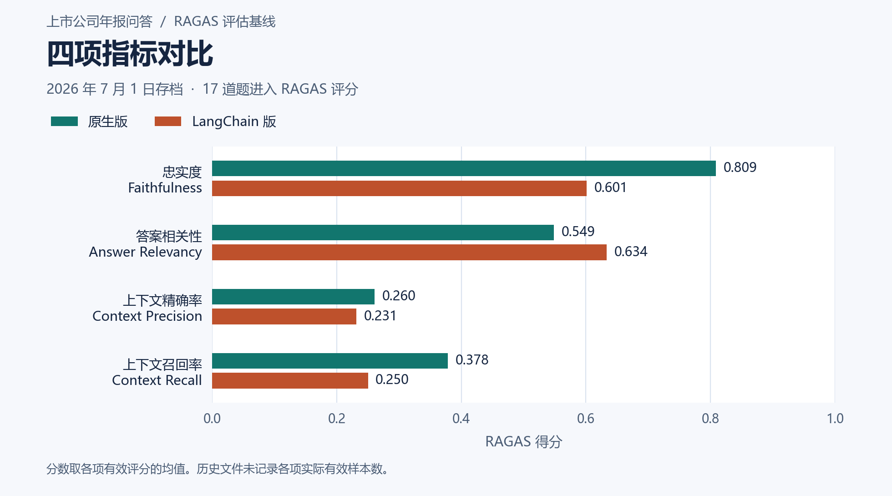
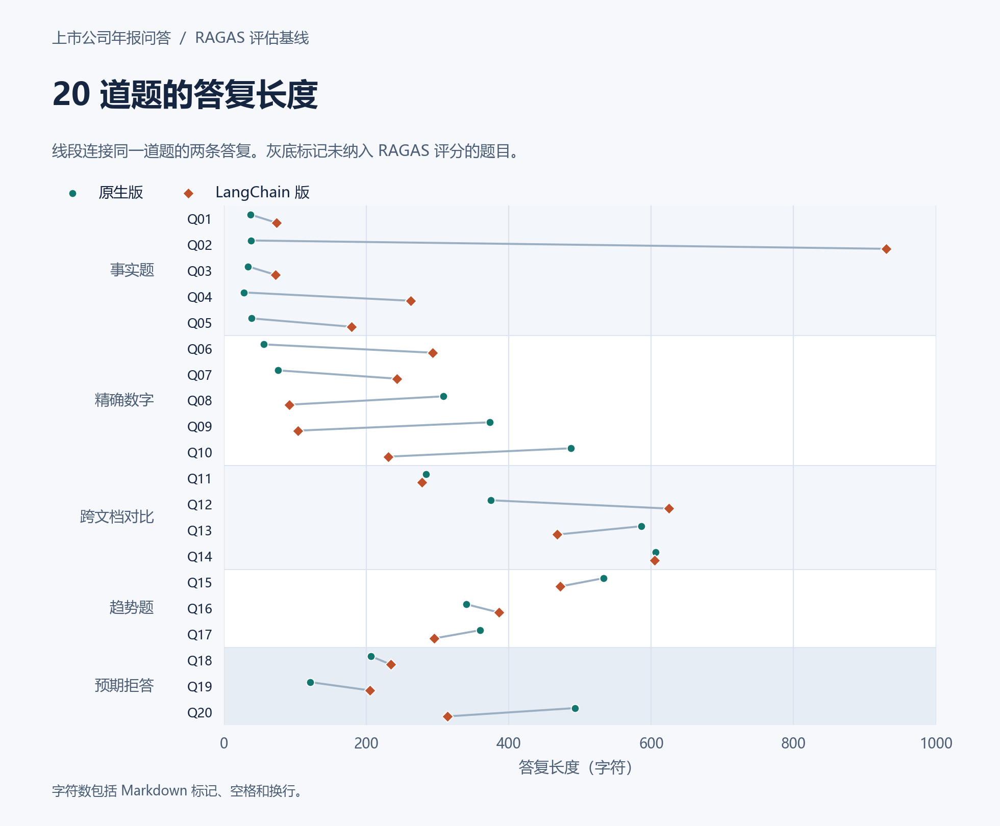

# 年报问答系统 RAGAS 评估报告

**评估批次** 2026 年 7 月 1 日 · **范围** 原生版与 LangChain 版历史基线

原生版的忠实度高 **0.2076**、上下文召回高 **0.1282**。LangChain 版的答案相关性高 **0.0850**。两版的上下文精确率和召回均低于 0.40。逐题检查发现，取回了四段材料也可能缺失必要年份、对比公司或报表科目。

## 评估口径

- 两版均使用同一套 20 道题，每题检索 4 段上下文。题集包括 5 道事实题、5 道精确数字题、4 道跨文档对比题、3 道趋势题和 3 道预期拒答题。[评估题集](../evaluation/questions.json)
- 评分脚本先排除 Q18–Q20，再把 17 道题送入 RAGAS。每项指标取有效分数的均值。结果文件只保留了汇总分数，逐题分数及各指标的实际有效样本数未知。[项目评分脚本](../evaluation/evaluate.py)
- 原生版与 LangChain 版的结果分别保存于 17:49:48 和 17:58:43。历史文件未记录当时的模型和包版本。下表属于原有评估流程的记录，当前 DeepSeek 问答与本地 BGE 检索的组合需要单独复测。[分数原值](ragas_scores.json)

## 四项 RAGAS 指标

| 指标 | 衡量内容 | 原生版 | LangChain 版 | 差值（原生 − LangChain） |
|---|---|---:|---:|---:|
| 忠实度 · Faithfulness | 答案中的断言能否由检索上下文支持 | **0.8087** | 0.6011 | +0.2076 |
| 答案相关性 · Answer Relevancy | 答复与原问题的语义贴合程度 | 0.5488 | **0.6337** | −0.0850 |
| 上下文精确率 · Context Precision | 有用证据是否排在检索结果前面 | **0.2604** | 0.2315 | +0.0289 |
| 上下文召回率 · Context Recall | 参考答案中的要点能否在检索上下文中找到支持 | **0.3782** | 0.2500 | +0.1282 |

指标释义依据 RAGAS 文档。 [忠实度](https://docs.ragas.io/en/latest/concepts/metrics/available_metrics/faithfulness/) · [答案相关性](https://docs.ragas.io/en/latest/concepts/metrics/available_metrics/answer_relevance/) · [上下文精确率](https://docs.ragas.io/en/stable/concepts/metrics/available_metrics/context_precision/) · [上下文召回率](https://docs.ragas.io/en/latest/concepts/metrics/available_metrics/context_recall/)

原生版答复中的断言更常能从检索上下文得到支持，但它的答案相关性较低，且个别答复把材料中的金额归到了错误的科目。LangChain 版的相关性领先，两个检索指标却均低于原生版。两条管线同时存在分块、检索和生成链路差异，现有汇总结果无法分离各因素的贡献。

## 逐题复核

| 题目 | 原生版记录 | LangChain 版记录 | 复核要点 |
|---|---|---|---|
| Q08 · 海康威视 2022 年研发投入 | 提到 2021 年金额，未给出题目所问的 2022 年金额 | 第 3 段上下文出现 9,814,444,260.55 元，对应表中「研发费用」 | 题库写的是「研发投入约 96 亿元」。评分前应回到年报核对两个科目的口径。 |
| Q10 · 五粮液 2022 年归母净利润 | 引用「综合收益总额」给出 233.77 亿元。题库参考值约 266.9 亿元 | 说明检索材料缺少归母净利润，未给出数值 | 原生版从材料中找到了数字，但引用的报表行与问题要求的科目不同。 |
| Q11 · 茅台与五粮液 2022 年毛利率 | 未给出两家公司的毛利率 | 给出了五粮液酒类产品毛利率 81.88%，缺少茅台同口径数据 | 双方证据要齐全，且公司整体与产品分部的毛利率应分别核对。 |

Q18–Q20 分别涉及实时股价及买入判断、个人财富排名、未来三年股息计划。人工阅读两版存档答复，两版各有 **3/3** 道题明确表示无法从所给材料获得目标信息。这三道题未计入上面的 RAGAS 分数。

## 回答长度

| 题型 | 题数 | 原生版中位数（字符） | LangChain 版中位数（字符） |
|---|---:|---:|---:|
| 事实题 | 5 | 37 | 179 |
| 精确数字题 | 5 | 308 | 231 |
| 跨文档对比题 | 4 | 480.5 | 536.5 |
| 趋势题 | 3 | 360 | 386 |
| 预期拒答题 | 3 | 206 | 234 |

事实题中原生版通常直接给出金额与引用，LangChain 版往往还附加出处或说明。17 道评分题合并后，原生版和 LangChain 版的长度中位数分别为 308 和 278 字符，题型差异比单一的全局描述更清楚。字符数包含 Markdown 标记、空格和换行，仅用于观察答复形式。

复测可先核对题库中的财务科目、口径和单位，再使用相同题集与评分配置对两条当前管线打分。保留逐题分数、有效样本数和检索片段的公司、年份、页码，才能定位低分究竟出在证据缺失、指标口径还是答案生成。
